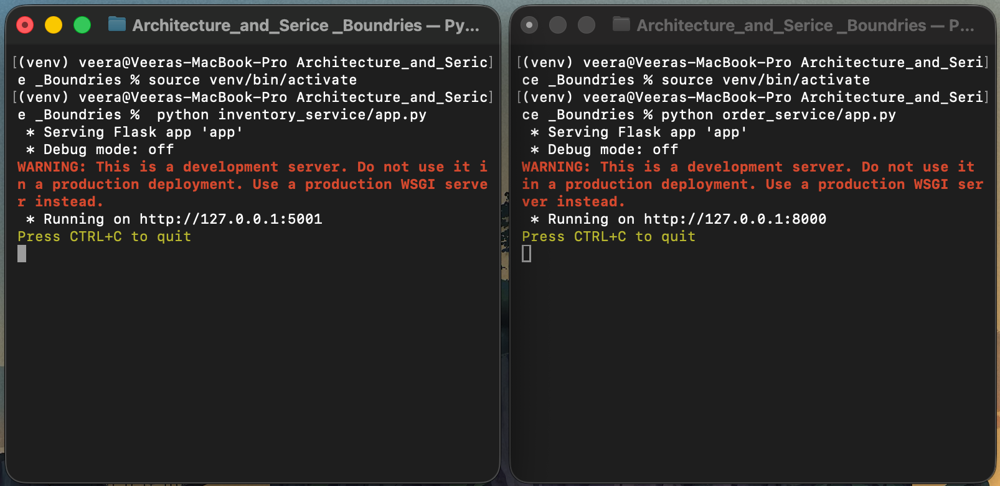
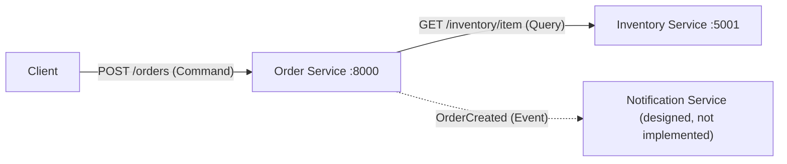
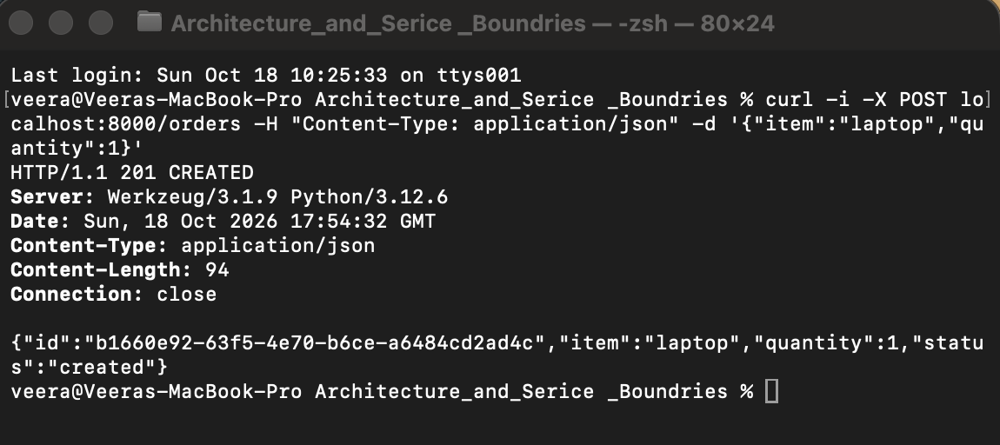
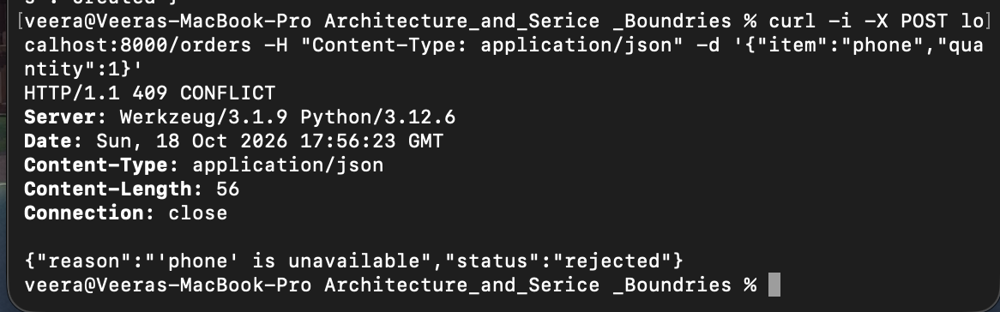
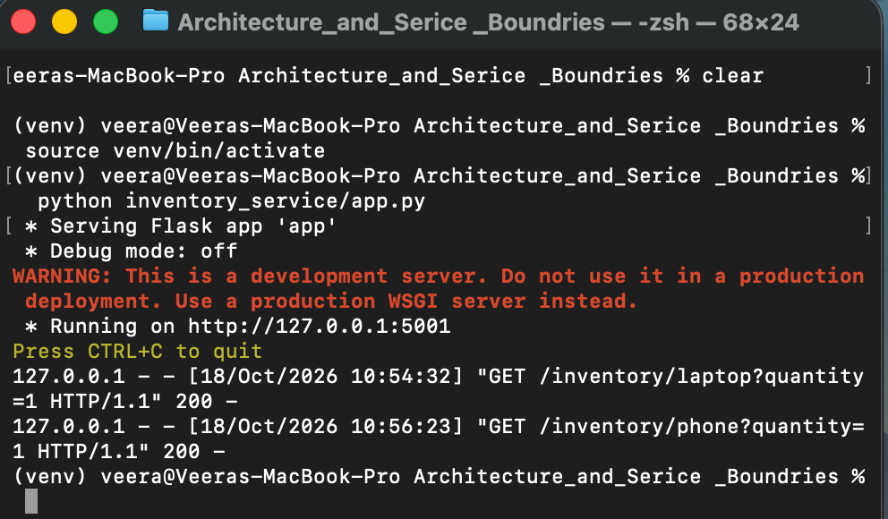
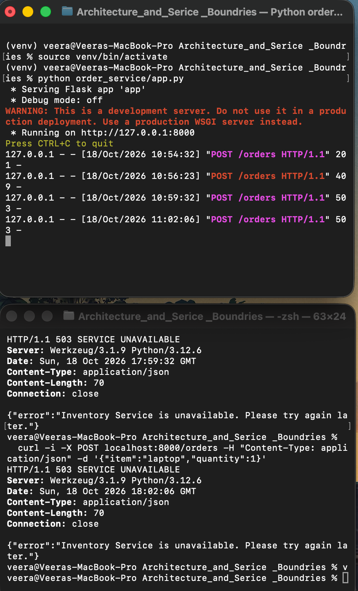

# Online Store: Order and Inventory Services

This is a small distributed application made with Python and Flask. It has an **Order Service** and an **Inventory Service**. They run as two separate processes and talk to each other over HTTP. I also planned a **Notification Service** in the design, but I did not build it.

## How to Install and Run

You need Python 3.9 or newer.

```bash
python3 -m venv venv
source venv/bin/activate        # Windows: venv\Scripts\activate
pip install -r requirements.txt
```

Run each service in its own terminal. Remember to activate the virtual environment in both terminals.

```bash
# Terminal 1: Inventory Service (port 5001)
python inventory_service/app.py
```

```bash
# Terminal 2: Order Service (port 8000)
python order_service/app.py
```

Here both services are running as separate processes:



## Architecture Diagram



The solid arrows are what I built. The dotted arrow shows how the Notification Service would get an event when an order is created.

## What Each Component Does

### Order Service
- **Responsibility:** It takes the order request from the user. It asks the Inventory Service if the item is available, then creates the order and keeps its status. If it cannot reach the Inventory Service, it returns a clear error message.
- **Data it owns:** The order records (order id, item, quantity and status).

### Inventory Service
- **Responsibility:** It keeps track of how many items are in stock and answers the availability questions from other services.
- **Data it owns:** The stock number for each item. I used sample data in memory: laptop = 5, phone = 0, headphones = 12.

### Notification Service (designed only, not built)
- **Responsibility:** It would tell the user that their order was created. It does this by listening to the `OrderCreated` event.
- **Data it would own:** The message templates, the delivery logs and the contact preferences of users.

## Why I Chose These Service Boundaries

Each service has only one job, so it has only one reason to change. Handling orders, checking stock and sending messages are different problems, so I kept them apart. Each service is the only owner of its own data. Other services must ask through the API, and they never read the data directly. This way there is one correct source for each type of data. Because of this separation, the services can also be built, deployed, scaled and fail independently. For example, when I stopped the Inventory Service in the failure test, the Order Service was still running and handled the problem without crashing.

## Command, Query and Event

| Interaction | Type | Why |
|---|---|---|
| Check whether an item is available | **Query** | It only reads data. It does not change anything and it just returns an answer (available or unavailable). |
| Create an order | **Command** | It asks the system to do an action and change the state. It goes to one service (the Order Service) and it can be rejected, for example when the item is not available. |
| Order was created | **Event** | It is a fact in the past tense that already happened. Other services like Notification can react to it, and the service that publishes it does not need to know who is listening. |

## Example: Successful Request

The Order Service asks the Inventory Service if a laptop is available. Inventory says "available", so the order is created.

```bash
curl -i -X POST localhost:8000/orders -H "Content-Type: application/json" -d '{"item":"laptop","quantity":1}'
```

```
HTTP/1.1 201 CREATED
Content-Type: application/json

{"id":"b1660e92-63f5-4e70-b6ce-a6484cd2ad4c","item":"laptop","quantity":1,"status":"created"}
```



## Example: Unavailable Item

The phone has zero stock. Inventory says "unavailable", so the Order Service rejects the order.

```bash
curl -i -X POST localhost:8000/orders -H "Content-Type: application/json" -d '{"item":"phone","quantity":1}'
```

```
HTTP/1.1 409 CONFLICT
Content-Type: application/json

{"reason":"'phone' is unavailable","status":"rejected"}
```



## Failure Test: Inventory Service Is Down

I stopped the Inventory Service with `Ctrl+C`. The screenshot below shows the two availability requests it handled before I stopped it.



After that, I sent another order:

```bash
curl -i -X POST localhost:8000/orders -H "Content-Type: application/json" -d '{"item":"laptop","quantity":1}'
```

```
HTTP/1.1 503 SERVICE UNAVAILABLE
Content-Type: application/json

{"error":"Inventory Service is unavailable. Please try again later."}
```

**Result:** The Order Service caught the connection error and returned HTTP 503 with a clear message. It did not crash. I sent one more request and got the same 503, so the Order Service was still running and answering. In the screenshot, the top window is the Order Service and its log has no errors. The bottom window shows both 503 responses.



## 
Why are clear service boundaries and data ownership important in a distributed architecture?

Clear service boundaries are important because each service has one purpose, so we can change one service without breaking the others. Data ownership is also important because only the owner can change its data, so there is one correct source and other services cannot damage it. In my test, the Inventory Service was down but the Order Service returned a clean 503 error and did not crash, so the problem stayed small. Without clear boundaries and data ownership, the system becomes a "distributed monolith", where services depend too much on each other and bugs are hard to find.
